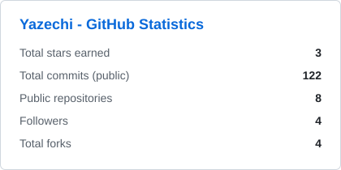
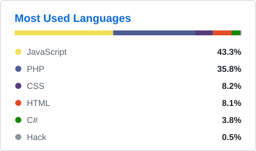

# Kevin Kristian Pakpahan

Full-stack web developer building interactive web applications with React, Three.js, PHP and Node.js, with a focus on clean architecture and practical AI integration.

---

## Projects

### SpaceView

An interactive space exploration application powered by multiple NASA APIs. Includes a 3D solar system visualization, live ISS tracking, a space weather dashboard, a near-Earth asteroid tracker and an exoplanet explorer with filterable data tables.

<table>
  <tr>
    <td width="50%">
    </td>
    <td width="50%">
    </td>
  </tr>
</table>

### Archive-Pulse

A self-hosted personal media hub for music, books and manga/comics. Features local uploads, playlists, progress tracking, PDF/EPUB/CBZ reading and a configurable reactive audio visualizer, backed by a Node.js and Express API.

<table>
  <tr>
    <td width="50%">
    </td>
    <td width="50%">
    
  </tr>  
</table>

### METREV

A car rental platform built with a team of four. Includes vehicle browsing and filtering, online ordering, email notifications, an administrator dashboard and an AI chat assistant powered by Google Gemini that answers questions about the car catalogue.

### Resonance

A web-based music player that streams audio through yt-dlp and mpv. Includes playlists, a play queue, a command-line mode and AI-driven song recommendations using Google Gemini.

---

## Technical Skills

**Languages**

**Frontend**

**Backend and databases**

**Tools**

---

GitHub Statistics

   

